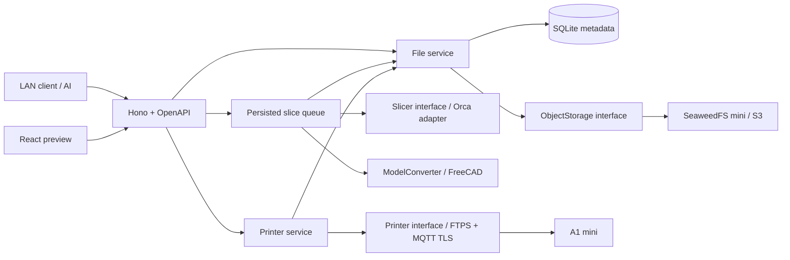

# アーキテクチャ

HTTP層→サービス→domain契約、adapterは契約を実装する。入力モデルの本体はS3、メタデータとキューはSQLite。キューは同じサーバープロセスで動くがHTTPハンドラーから独立し、Slicerの交換はDIで可能。将来MCPはサービスへの新しい入口として追加。

HTTPサーバーは既定で `0.0.0.0:3000` に待ち受け、React/Swagger/APIを同じオリジンでLANクライアントへ配信する。mDNS名はホストOSのAvahi等が解決し、アプリにmDNS依存は追加しない。LANのIPv4または `ホスト名.local` から接続し、API/プレビューのデータ取得にはBearer認証を使う。`HOST=127.0.0.1` でローカル限定に切替可能。SeaweedFSはloopback公開のままとする。

データフロー: ①UUID/staging作成→ストレージ保存→ready ②queuedジョブ保存→running→必要時STEP変換→Orca→成果物保存→succeeded/resultFileId ③UUID→ファイルの形式確認→FTPS ④明示的印刷API→永続冪等キー登録→アップロード→MQTT要求→ACK/結果不明を保存。

単一プロセス・単一DB。スライス1並列、待機上限20。停止時新規受付を止め、実行中ジョブの完了を待つ。クラッシュ後runningはfailed、queuedは再開。実機印刷の再送はしない。
境界間の原子的トランザクションは不可能なのでstaging/ready/failedと起動時照合を採用。ログはUUIDと安全なエラーコード中心。APIの内部エラーに資格情報・パスを含めない。

起動時にSQLiteのserver_ownerをBEGIN IMMEDIATEで取得し、同じDATA_DIRを別サーバーが使用中なら拒否する。死んだPIDの所有権のみ再取得して復旧し、実行中の一時領域を別プロセスが削除する事故を防ぐ。複数ホストでDBを共有する運用は対象外。

外部CLI実行はnative/DockerのCommandRunnerを選択できる。SlicerとConverterの契約は共通。隔離ツールはネットワーク無効、入力/出力/管理者プロフィールのみを共有し、APIサーバーの資格情報を保持しない。
