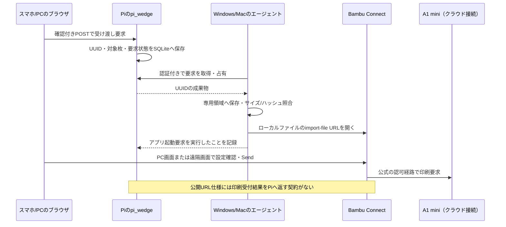

# Bambu Connect連携の詳細調査（2026-10-22）

[LAN Onlyを使わない印刷の調査](cloud-printing-research.md)の追調査。公式Wiki本文・直近リリース・公開実装・pi_wedgeのコードを確認した。Connect本体のインストール・起動、アカウントへのログイン、プリンター操作は行っていない。

## 判断

Bambu Connectは、クラウドへ接続したプリンターに公式の認可を使って印刷するためのデスクトップアプリである。pi_wedgeから公開仕様で渡せるのはローカルファイルの読み込み要求まで。Connect側でプレート・プリンター・供給元・設定を選び、ユーザーが送信する手順が残る。

- **Windows/Macも使う**: Piから成果物を渡す中継を実装する候補になる。最初は手動ダウンロードで互換性を確認すればよい。
- **スマホで操作を終えたい**: 上記PCの画面をスマホへ配信してConnectを操作する案がある。これは構成上の推論であり、当環境では未検証。PC自体は必要になる。
- **Piとスマホだけで動かしたい**: Linux ARM64の公式Connect配布と、画面なしの印刷APIを確認できないため、公式の公開仕様で成立する経路は得られなかった。

「PC上で最終確認が必要」は「PCの前に座る必要がある」と同義ではない。前回調査の説明は、この区別を補足する。

## 公式本文で確認できたこと

初回はブラウズツールから公式Wikiを取得できなかったが、今回は公開ページへの直接HTTPS GETで英語・中国語の本文を取得できた。HTMLの保存先は `/tmp/pi-wedge-bambu-connect-research/`。本文の転載やバイナリはリポジトリへ保存しない。

| 項目         | 公式資料の内容                                                  | pi_wedgeへの意味                            |
| ------------ | --------------------------------------------------------------- | ------------------------------------------- |
| 配布版       | ダウンロード欄は `2.5.0-beta.15`、履歴では2026-08-13公開        | アプリ版を固定して試験する                  |
| Windows      | Windows 10以降、x86_64                                          | Windows ARM64ネイティブ版は掲載なし         |
| macOS        | macOS 13以降、arm64 / x86_64                                    | Apple Silicon版はPi用Linuxバイナリではない  |
| Linux        | 開発中                                                          | Piへそのまま導入する公式配布なし            |
| クラウド接続 | アカウントへログインし、紐付いたプリンターを選べる              | LAN Onlyへ切り替えず使う経路がある          |
| LAN接続      | LANモードのプリンターを別途検出できる                           | クラウド接続とLAN Onlyを同一視しない        |
| 読み込み     | Bambu向けにスライス済みのG-code / 3MF                           | STL/STEPをConnectがスライスする用途ではない |
| 印刷操作     | ファイル読込 → プレート選択 → Print → プリンター等を選択 → Send | URLを開いただけでは印刷されない             |

出典: [公式Connectガイド](https://wiki.bambulab.com/en/software/bambu-connect)、[第三者連携仕様](https://wiki.bambulab.com/en/software/third-party-integration)、[リリース一覧](https://wiki.bambulab.com/en/software/bambu-connect/releases)。直近3版の本文も確認した。[beta.15](https://wiki.bambulab.com/en/software/bambu-connect/releases/v2_5_0-beta_15)はセキュリティ修正、[beta.12](https://wiki.bambulab.com/en/software/bambu-connect/releases/v2_5_0-beta_12)は機種追加とIntel Macの印刷開始クラッシュ・AMS併設時の外部スプール印刷の修正、[2.4](https://wiki.bambulab.com/en/software/bambu-connect/releases/v2_4_0-beta_10)は機種追加で、これらに自動印刷API追加の記載はなかった。

クラウドログインの経路なら、認証処理はConnect内で完結させられ、PiがBambuのパスワードやトークンを保管する必要はない。Handy併用はクラウド接続を維持する構成から期待できるが、当A1 miniでConnectとHandyを同時に使った実機検証は未実施。印刷データの実際の転送経路やクラウド保存も通信確認前に断定しない。

## URLで指定できる範囲

公式に掲載されている形式は次のとおり。`version` はアプリ版ではなく受け渡しのプロトコル版である。

```text
bambu-connect://import-file?path=%2Ftmp%2Fcube.gcode.3mf&name=Cube&version=1.0.0
```

| パラメーター | 役割                                | 制約                                                |
| ------------ | ----------------------------------- | --------------------------------------------------- |
| `path`       | Connectが動く端末の絶対ファイルパス | 値を `encodeURIComponent` でエンコードする          |
| `name`       | 表示名                              | プリンター名やIDを指定する項目ではない              |
| `version`    | 仕様上 `1.0.0`                      | ダウンロードしたアプリの `2.5.0-beta.15` を入れない |

出典: [公式URL仕様](https://wiki.bambulab.com/en/software/bambu-connect#launching-bambu-connect-from-third-party-software)。プリンターID、AMSマッピング、プレート番号、即時開始、完了通知先を指定するパラメーターは掲載されていない。公開されたHTTP印刷エンドポイント、無人実行CLI、受付結果のコールバックも今回の資料では確認できなかった。「内部実装に存在しない」という断定ではなく、依存できる公開契約が得られないという判断。

`path` はダウンロードURLではない。Pi上の `/tmp/...` はWindows/Macから読めず、スマホでこのURLを開いてもPC上のConnectは起動しない。PC側にファイルを保存し、そのPCでURLを開く必要がある。

公開例には差異がある。[STEVEの現行実装](https://github.com/stevecad/steve-bambu-connector/blob/main/lib/bambuconnect.js)は二重エンコードと `version=1.1.0` を使い、[Bambu開発者による2025年の参考実装](https://github.com/OrcaSlicer/OrcaSlicer/commit/375839610c2c86579888e7810afa0cd8a1976b15)はさらに異なる組み立て方をしている。いずれも現在の公式ガイドを上書きする仕様とは扱わない。まず公式形式とUUIDのASCIIファイル名で試し、日本語・空白・`&`・`#`・`%`を含む表示名と保存パスを追加検証する。

## 現在の3MFをそのまま渡せるか

読み込み互換性は未検証。現在の `src/adapters/orca.ts` はOrca 2.4.2の `--export-3mf` を使い、形状とG-codeを含む成果物を保存する。`--min-save` は指定していない。追加プレートは `scripts/append-plate.py` で結合し、ダウンロードは `src/preview-routes.ts` が集合の3MF全体を返す。

[Orca 2.4.2のソース](https://github.com/OrcaSlicer/OrcaSlicer/blob/v2.4.2/src/OrcaSlicer.cpp)では `min_save` は保存時の `SkipModel` フラグへ反映される。[Bambu開発者の回答](https://github.com/bambulab/BambuStudio/issues/2930#issuecomment-1821964625)も、CLI生成物をスライス済みとして読み込む際の `--min-save` を案内している。ただし、これはConnect最新版での受入れ保証ではない。

[bambox作者の試験報告](https://github.com/estampo/bambox/blob/main/docs/gcode-3mf-format.md)では、モデル入り形式とスライス済み形式の違い、設定・プレート情報等による読込失敗を報告している。これは特定環境の実装者による一次報告であり、A1 mini用の普遍的な必須キー表ではない。報告中のP1S用スロット数、設定キー数、固定ベッド値やクライアント版を当プロジェクトへそのまま移植しない。

検証は以下の順で行う。

1. 現在の単一プレート3MFをConnectへ手動で読み込み、A1 mini・0.4mm・PLA・プレート・統計・供給元が正しく表示されるか確認する。Sendは押さずに実施できる。
2. 同じG-codeを含むスライス済み専用形式と比較し、差異を特定する。必要ならConnect用成果物を別UUIDで派生生成し、保存済みの編集用3MFや既存プレートを変更しない。G-codeのハッシュが変わらないことを確認する。
3. 複数プレート3MFを読み込み、枚数と各枚の識別を確認する。ページで選んだ枚がURLで自動選択されるとは扱わない。実装時は選択枚だけの派生ファイルにするか、Connect側で選び直す仕様を明示する。
4. 外部スプール・AMS Liteの設定表示を確認する。現在のページの供給設定がConnectへ自動反映される根拠はないため、開始に使う設定はConnect側で確認する。

`--min-save` の有効化だけで解決するとの結論は出せない。また、形状を除くことで現在の追加プレート機能へ影響するため、既存スライサー出力の全体切替から始めない。

## PiとPCをつなぐ構成案



上図は提案であり未実装。最初の試作は専用エージェントなしで手動ダウンロード → Connectへドラッグで十分。読込互換性が確認できてから、受け渡しキューとエージェントを作る。

エージェントはユーザーのデスクトップセッションで動かす。起動中のPCがスリープやログアウトしている場合に失敗を検出できる必要がある。PiからPCへ任意パスや任意URLを渡さず、UUIDの成果物だけをエージェントが専用ディレクトリへ保存する。API用資格情報はPC内に保管し、ブラウザへ渡さない。

受け渡しの冪等性と印刷の冪等性は別。OSのURL起動が成功しても読み込み成功や印刷受付は証明できない。`received` / `handed_off` / `handoff_unknown` 等の状態を現在の `accepted` と分ける。占有後にPCが落ちた場合、リース切れで自動再配信すると既に開いたConnectへ二重に渡す可能性があるため、結果不明として確認に回す。Connectが読む前に一時ファイルを消さない。占有と保管期限、明示的な取消・再受け渡しの仕様が必要。

現行の `PrinterService` は `Printer.startPrint` が成功すると `accepted` を保存する。ConnectのURL起動だけをこのメソッドへ実装すると受付を誤認するため、受け渡し用のユースケースと永続レコードを分ける必要がある。状態取得を追加する場合も、対象ジョブとの照合を定義するまでは単にプリンターがRUNNINGになったことを受け渡し成功の根拠にしない。

## スマホのブラウザで最終確認する案

[noVNCの公式説明](https://novnc.com/info.html)はiOS/Androidのブラウザ対応と、VNCサーバー・WebSocketプロキシを使う構成を案内している。Windows/MacにConnectとVNCサーバーを置き、その画面をスマホから操作すれば、PCの前へ移動せず本人がSendを押す構成は考えられる。

これはConnectのWeb APIを使う方法ではなく、ネイティブ画面の遠隔操作。別PC・画面セッション・遠隔操作用認証が必要で、390px幅の操作性や復帰・切断時の挙動は未検証。画面にはBambuアカウントやPCの他の情報も映るため、現在の認証なしLANプレビューへそのまま公開せず、認証された遠隔セッションとして設計する。一般のデスクトップ共有をページへ埋め込むことと、限定された印刷APIを公開することは権限範囲が異なる。

## Pi上のDockerや互換実行環境は解決策か

公式配布はWindows/macOS用なので、Linuxコンテナ化するだけではLinux ARM64アプリにはならない。Wine・CPUエミュレーション・仮想Windows・GUI配信を重ねる案の動作や安定性は今回確認できず、Pi 5 8GBの運用経路として採用する根拠はない。

検索で見つかる[OctoEverywhereのBambu Connect Docker](https://blog.octoeverywhere.com/setup-bambu-connect-with-docker-or-docker-compose/)は、同社の連携ソフトを指す。記事は `octoeverywhere/octoeverywhere` イメージとプリンターのIP・シリアル・アクセスコードを使う。Bambu Lab公式ConnectのLinux版や公式URL APIのサーバー版を提供する記事ではない。同名のため混同しない。

公式の[第三者連携仕様](https://wiki.bambulab.com/en/software/third-party-integration)にあるHTTP API・Docker SDKは別製品のBambu Local Serverについての説明。ConnectのHTTPエンドポイントとは扱えない。同ページのLocal Server要件もWindows x86_64でLinux/ARM64は開発中となっている。Fleet HubとHandyの併用制限は[前回調査](cloud-printing-research.md#fleet-hubは今回の解決策になるか)を参照。

## 次に行う最小の検証

Windows/Macが使える場合、公式版Connectを入れたPCで、LAN OnlyをOFFのままHandyとConnectの同じアカウントにプリンターが表示されるか確認する。そのPCで、現在の単一3MFの読込、複数プレートの読込、公式URLの読込を順番に確認する。この段階ではSendを押す必要はない。

ここまで成功すれば、ファイル互換性と受け渡しは成立する。次にエージェントと、必要に応じたスマホからの遠隔操作を試作する。実際の開始は供給元とベッドを確認した明示操作で一度だけ行い、Connect上の受付・実機開始・Handyでの表示を別々に記録する。今回これらの動作結果は得ていない。
